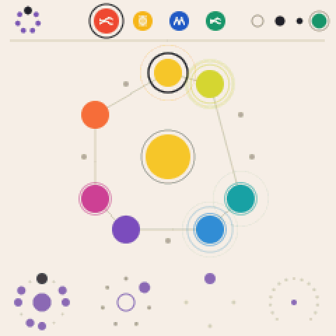
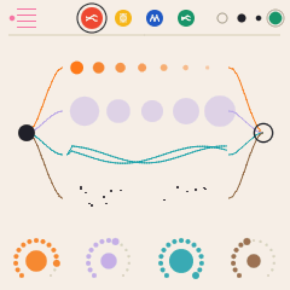

# WHYWHYWHY

  
  
  

  
  
  

> [!WARNING]
> **Not tested on a real FM‑1 yet.** WHYWHYWHY has been tested on a computer (the Dinghy host simulator). Install it
> at your own risk, and keep the stock firmware or another firmware ready to flash back.

WHYWHYWHY is a firmware for the **M‑VAVE FM‑1**, made for exploring. **There are no words on its screen.** Four
coloured buoys (the four parts) float on a sheet of paper, and what you hear moves them: ripples, facets, polka
dots, gratings, folded tape, flowing contours. Turn a knob and watch what moves.

- **Six algorithms**, one per part, chosen with **ALGORITHM**: **GLASS** (inharmonic FM: glass, ice, bells),
  **BIRCH** (struck partials: wood, bars, bowls, skins), **DOTS** (a cloud of sine grains), **PULSE** (a sine, a
  click, a beat, data grit, a tempo gate), **FOLD** (a folded sine with a hand‑made wobble), **AIR** (breath through
  a resonance).
- **Every button does what it says.** EDIT edits the sound, ENV is the envelope, LFO the LFO, ARP the arpeggiator,
  SEQ the sequencer, FX the effects, GLO the globals, SAVE saves, PRESETS recalls, REC records, PLAY plays. SEL is
  the **scale** page; HOME is the mixer. One page each, no menus.
- **ARP**: nine patterns, rates, 1–4 octaves, and WANDER, which lets steps stray.
- **SEQ**: four tracks, 0–32 sixteenths each: four loops drifting in and out of phase. Record over them.
- **The scale comes last**: 55 scales, common and exotic, with MODE, GRAVITY (all notes → root only) and **TRUE
  TUNING** (from equal steps to pure intervals, pelog, slendro, maqam quarter tones). On the SCALE page the keys
  move the whole synth.
- **Four effects in parallel**: echo, hall, chorus, dust.
- **Eight scenes**: SAVE keeps one; an empty one is a **new random piece** every time you land on it.
- **Hold any page button** to throw the dice for that page.

[Operator manual](docs/OPERATOR-MANUAL.md) · [Demo film with sound](docs/demo.mp4) · [Build and test](docs/BUILDING.md) · [Credits and licenses](LICENSING.md)

**Version 0.1.0** builds as `whywhywhy_0.1.0.fwsc` (package identity `FM-1_947113`).

## Credits

WHYWHYWHY builds on [Dinghy](https://github.com/zvenson/dinghy) by zvenson and the
[Felucca](https://github.com/hugelton/Felucca) and [SLOOP](https://github.com/isod89/sloop-fm1) platform work it
carries, and on the delay, hall and chorus of [LOOPHEADS](https://github.com/jaak-stjaaques/LOOPHEADS-public) and
BEACHCOMBER. The pictures look towards Carsten Nicolai, Yayoi Kusama, Damien Hirst, Tom Sachs, Alvar Aalto and
Tapio Wirkkala without copying them.

The firmware is distributed under [GPL-3.0-only](LICENSE). The [full credits](LICENSING.md) retain the upstream
notices.
