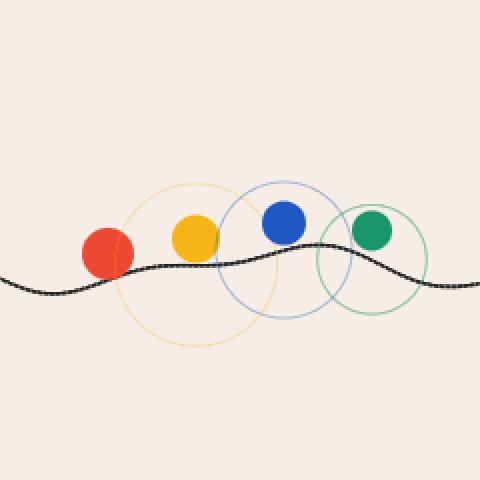
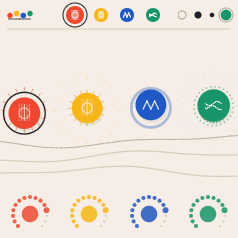
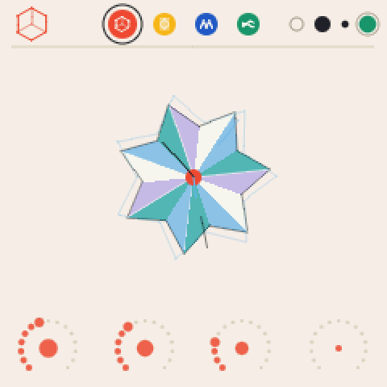
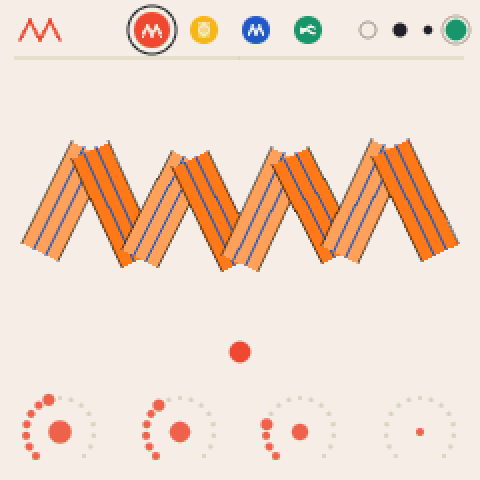

# whywhywhy

  
  
  

  
  
  

> [!WARNING]
> **Not tested on a real FM‑1 yet.** WHYWHYWHY has been tested on a computer (the Dinghy host simulator). Install it
> at your own risk, and keep the stock firmware or another firmware ready to flash back.

whywhywhy whywhywhy whywhywhy whywhywhy whywhywhy whywhywhy **whywhywhy‑whywhywhy whywhywhy‑1**, whywhywhy whywhywhy whywhywhy. **whywhywhy whywhywhy whywhywhy whywhywhy whywhywhy whywhywhy whywhywhy.** whywhywhy
whywhywhy whywhywhy (whywhywhy whywhywhy whywhywhy) whywhywhy whywhywhy whywhywhy whywhywhy whywhywhy whywhywhy, whywhywhy whywhywhy whywhywhy whywhywhy whywhywhy whywhywhy: whywhywhy, whywhywhy, whywhywhy
whywhywhy, whywhywhy, whywhywhy whywhywhy, whywhywhy whywhywhy. whywhywhy whywhywhy whywhywhy whywhywhy whywhywhy whywhywhy whywhywhy.

- **whywhywhy whywhywhy**, whywhywhy whywhywhy whywhywhy, whywhywhy whywhywhy **whywhywhy**: **whywhywhy** (whywhywhy whywhywhy: whywhywhy, whywhywhy, whywhywhy),
  **whywhywhy** (whywhywhy whywhywhy: whywhywhy, whywhywhy, whywhywhy, whywhywhy), **whywhywhy** (whywhywhy whywhywhy whywhywhy whywhywhy whywhywhy), **whywhywhy** (whywhywhy whywhywhy, whywhywhy
  whywhywhy, whywhywhy whywhywhy, whywhywhy whywhywhy, whywhywhy whywhywhy whywhywhy), **whywhywhy** (whywhywhy whywhywhy whywhywhy whywhywhy whywhywhy whywhywhy‑whywhywhy whywhywhy), **whywhywhy** (whywhywhy whywhywhy
  whywhywhy whywhywhy).
- **whywhywhy whywhywhy whywhywhy whywhywhy whywhywhy whywhywhy.** whywhywhy whywhywhy whywhywhy whywhywhy, whywhywhy whywhywhy whywhywhy whywhywhy, whywhywhy whywhywhy whywhywhy, whywhywhy whywhywhy whywhywhy,
  whywhywhy whywhywhy whywhywhy, whywhywhy whywhywhy whywhywhy, whywhywhy whywhywhy whywhywhy, whywhywhy whywhywhy, whywhywhy whywhywhy, whywhywhy whywhywhy, whywhywhy whywhywhy. whywhywhy whywhywhy
  whywhywhy **whywhywhy** whywhywhy; whywhywhy whywhywhy whywhywhy whywhywhy. whywhywhy whywhywhy whywhywhy, whywhywhy whywhywhy.
- **whywhywhy**: whywhywhy whywhywhy, whywhywhy, 1–4 whywhywhy, whywhywhy whywhywhy, whywhywhy whywhywhy whywhywhy whywhywhy.
- **whywhywhy**: whywhywhy whywhywhy, 0–32 whywhywhy whywhywhy: whywhywhy whywhywhy whywhywhy whywhywhy whywhywhy whywhywhy whywhywhy whywhywhy. whywhywhy whywhywhy whywhywhy.
- **whywhywhy whywhywhy whywhywhy whywhywhy**: 55 whywhywhy, whywhywhy whywhywhy whywhywhy, whywhywhy whywhywhy, whywhywhy (whywhywhy whywhywhy → whywhywhy whywhywhy) whywhywhy **whywhywhy
  whywhywhy** (whywhywhy whywhywhy whywhywhy whywhywhy whywhywhy whywhywhy, whywhywhy, whywhywhy, whywhywhy whywhywhy whywhywhy). whywhywhy whywhywhy whywhywhy whywhywhy whywhywhy whywhywhy
  whywhywhy whywhywhy whywhywhy whywhywhy.
- **whywhywhy whywhywhy whywhywhy whywhywhy**: whywhywhy, whywhywhy, whywhywhy, whywhywhy.
- **whywhywhy whywhywhy**: whywhywhy whywhywhy whywhywhy; whywhywhy whywhywhy whywhywhy whywhywhy whywhywhy **whywhywhy whywhywhy whywhywhy** whywhywhy whywhywhy whywhywhy whywhywhy whywhywhy whywhywhy.
- **whywhywhy whywhywhy whywhywhy whywhywhy** whywhywhy whywhywhy whywhywhy whywhywhy whywhywhy whywhywhy whywhywhy.

[whywhywhy whywhywhy](docs/OPERATOR-MANUAL.md) · [whywhywhy whywhywhy whywhywhy whywhywhy](docs/demo.mp4) · [whywhywhy whywhywhy whywhywhy](docs/BUILDING.md) · [whywhywhy whywhywhy whywhywhy](LICENSING.md)

**whywhywhy 0.1.0** whywhywhy whywhywhy `whywhywhy_0.1.0.whywhywhy` (whywhywhy whywhywhy `whywhywhy-1_947113`).

## Credits

WHYWHYWHY builds on [Dinghy](https://github.com/zvenson/dinghy) by zvenson and the
[Felucca](https://github.com/hugelton/Felucca) and [SLOOP](https://github.com/isod89/sloop-fm1) platform work it
carries, and on the delay, hall and chorus of [LOOPHEADS](https://github.com/jaak-stjaaques/LOOPHEADS-public) and
BEACHCOMBER. The pictures look towards Carsten Nicolai, Yayoi Kusama, Damien Hirst, Tom Sachs, Alvar Aalto and
Tapio Wirkkala without copying them.

The firmware is distributed under [GPL-3.0-only](LICENSE). The [full credits](LICENSING.md) retain the upstream
notices.
